<p>
  <a href="https://github.com/ZxzZhao6668/Lum-OpenSource">
    
  </a>
</p>

<p align="center">
  <a href="../../README.md">简体中文</a> |
  <a href="./readmeZhTw.md">繁體中文</a> |
  <a href="./readmeEn.md">English</a> |
  <a href="./readmeJa.md">日本語</a> |
  <a href="./readmeRu.md">Русский</a> |
  <a href="./readmeVi.md">Tiếng Việt</a> |
  <a href="./readmeTh.md">ไทย</a>
  <br />
  <a href="./readmeKo.md">한국어</a> |
  <a href="./readmeHi.md">हिन्दी</a> |
  <a href="./readmeId.md">Bahasa Indonesia</a> |
  <a href="./readmeMs.md">Bahasa Melayu</a> |
  <a href="./readmeFil.md">Filipino</a> |
  <a href="./readmeBn.md">বাংলা</a> |
  <a href="./readmeUr.md">اردو</a>
  <br />
  <a href="./readmeTa.md">தமிழ்</a> |
  <a href="./readmeTe.md">తెలుగు</a> |
  <a href="./readmeMr.md">मराठी</a> |
  <a href="./readmePa.md">ਪੰਜਾਬੀ</a> |
  <a href="./readmeAr.md">العربية</a> |
  <strong>فارسی</strong> |
  <a href="./readmeTr.md">Türkçe</a>
</p>

> 🌐 **رابط کاربری به 21 زبان** · [مشاهدهٔ زبان‌های پشتیبانی‌شده](#languages)

<div align="center">

<p align="center">
  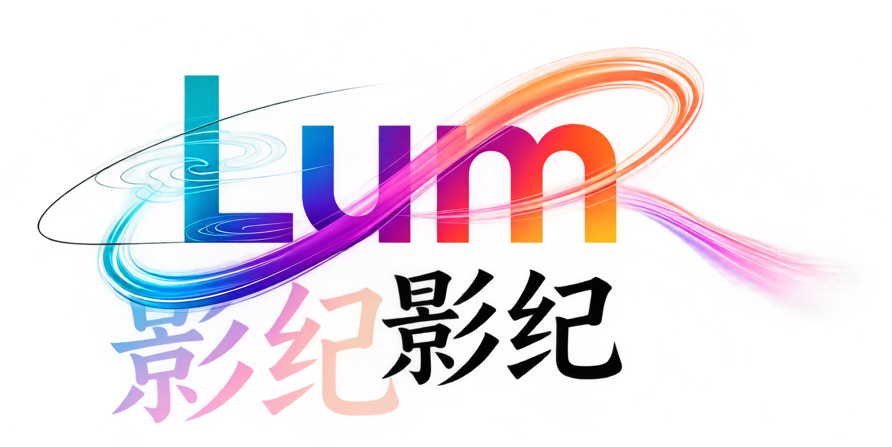
</p>

<a href="https://github.com/ZxzZhao6668/Lum-OpenSource">
  <picture>
    <source media="(prefers-color-scheme: dark)" srcset="https://readme-typing-svg.demolab.com?font=Fira+Code&size=40&duration=3000&pause=1000&color=FFFFFF&center=true&vCenter=true&width=600&lines=Lum;AI%20Short%20Drama%20Studio;Turn%20ideas%20into%20stories" />
    
  </picture>
</a>

<p align="center">
  <a href="https://github.com/ZxzZhao6668/Lum-OpenSource/stargazers">
    
  </a>
  <a href="../../LICENSE">
    
  </a>
  <a href="https://github.com/ZxzZhao6668/Lum-OpenSource/releases">
    
  </a>
</p>
<p align="center">
  <a href="https://github.com/ZxzZhao6668/Lum-OpenSource/forks">
    
  </a>
</p>
<p align="center">
  <a href="https://github.com/ZxzZhao6668/Lum-OpenSource/issues">
    
  </a>
  <a href="https://github.com/ZxzZhao6668/Lum-OpenSource/graphs/contributors">
    
  </a>
  <a href="https://github.com/ZxzZhao6668/Lum-OpenSource/commits">
    
  </a>
</p>
<p align="center">
  &nbsp;
  &nbsp;
  &nbsp;
  
</p>


**پلتفرم متن‌باز هوش مصنوعی برای ساخت سریال‌های کوتاه، کمیک‌های متحرک و ویدیو**

> 🚀 **ساخت یکپارچهٔ سریال کوتاه**: فیلم‌نامه بنویسید، دارایی‌ها را مدیریت کنید و تصویر و ویدیو بسازید؛ همهٔ مراحل کار خلاقانهٔ شما روی یک بوم بی‌نهایت کنار هم قرار می‌گیرند.

</div>

<p align="center">
  <a href="https://github.com/ZxzZhao6668/Lum-OpenSource/releases">دانلود</a> ·
  <a href="../../../../docs/user-guide.md">راهنمای کاربر</a> ·
  <a href="../../../../marketplace/README.md">بازار افزونه‌ها</a> ·
  <a href="../development.md">مستندات توسعه‌دهندگان</a> ·
  <a href="../../../../docs/user-guide.md#配置-ai">تنظیمات مدل</a>
</p>

---

## 1. 💛 حامیان و پشتیبانی

از شرکای زیر برای حمایت از پروژهٔ متن‌باز Toonflow (HBAI-Ltd) سپاسگزاریم.

Metaso · APIMart · CompShare

[Lum · حامی پروژه شوید](../../../../docs/contact.md#business)

---

## 2. 🌟 قابلیت‌های برجسته

Lum پلتفرمی متن‌باز برای خلق سریال‌های کوتاه، کمیک‌های متحرک و ویدیوهای کوتاه با هوش مصنوعی است که فیلم‌نامه‌ها، دارایی‌ها و کلیپ‌های ویدیویی را روی یک بوم بی‌نهایت گرد هم می‌آورد.

| قابلیت | توضیح |
| --- | --- |
| 🏠 **اجرای محلی** | پروژه‌ها و دارایی‌ها را روی دستگاه یا سرور خود نگه دارید؛ با گزینه‌های برنامهٔ دسکتاپ، Android، Docker و استقرار روی سرور. |
| 🖼️ **بوم بی‌نهایت** | فیلم‌نامه‌ها، شخصیت‌ها، صحنه‌ها و کلیپ‌های ویدیویی را روی یک بوم سازمان‌دهی کنید. |
| 🔌 **MCP** | ابزارها و سرویس‌های بیرونی را از طریق MCP متصل کنید. |
| 🧩 **بازار افزونه‌ها** | گره‌ها، ابزارها و قابلیت‌های خلاقانه را از طریق [بازار افزونه‌ها](../../../../marketplace/README.md) گسترش دهید. |
| 🤖 **Agent باز** | دسترسی باز به پرامپت‌ها، ابزارها و A2A برای سفارشی‌سازی رفتار Agent و همکاری با عامل‌های بیرونی. |
| 🔧 **اتصال انعطاف‌پذیر مدل‌ها** | APIهای شخص ثالث را پیکربندی کنید یا نمونه‌های محلی ComfyUI و مدل‌های زبانی بزرگ را متصل کنید. |
| 🌐 **پشتیبانی چندزبانه** | رابط کاربری از 21 زبان پشتیبانی می‌کند. |

<a id="languages"></a>

### پشتیبانی چندزبانه

زبان‌های پشتیبانی‌شده: 简体中文، 繁體中文، English، 日本語، Русский، Tiếng Việt، ไทย، 한국어، हिन्दी، Bahasa Indonesia، Bahasa Melayu، Filipino، বাংলা، اردو، தமிழ்، తెలుగు، मराठी، ਪੰਜਾਬੀ، العربية، فارسی، Türkçe.

---

## 3. 📸 تصاویر محیط برنامه

<div align="center">

<a href="../images/screenshots/projectHome.png">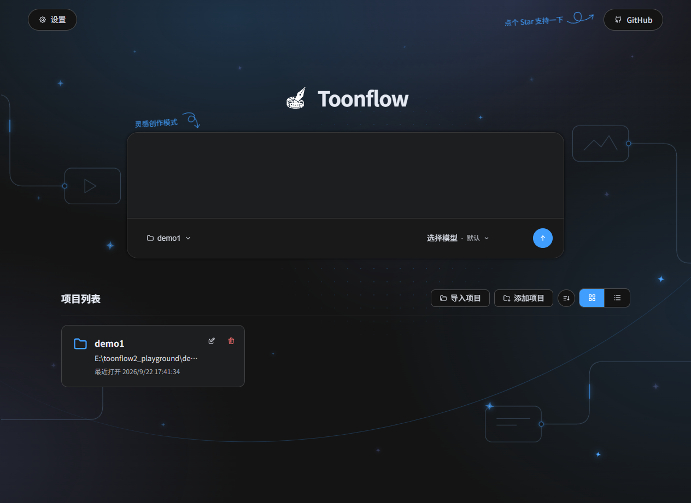</a><br /><sub>صفحهٔ اصلی پروژه و ایده‌پردازی</sub>

<a href="../images/screenshots/quickStart.png">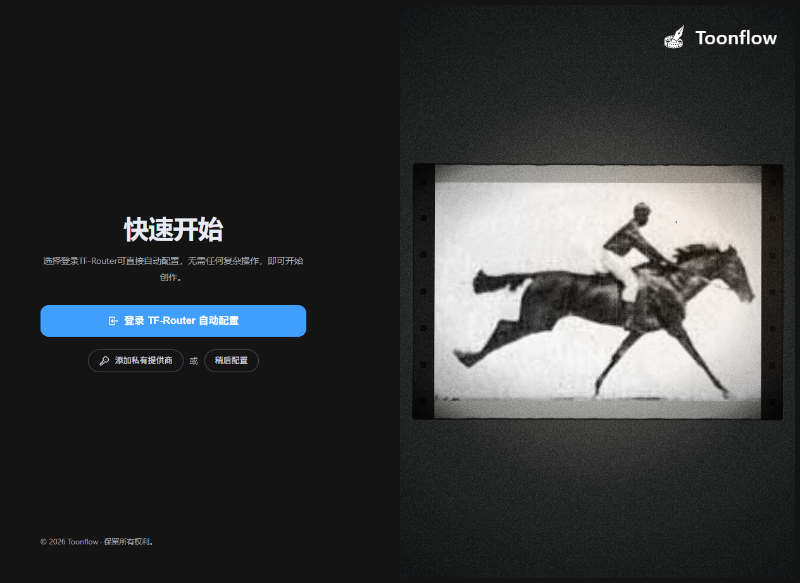</a><br /><sub>اجرای نخست و راه‌اندازی سریع</sub>

<a href="../images/screenshots/canvasDark.png">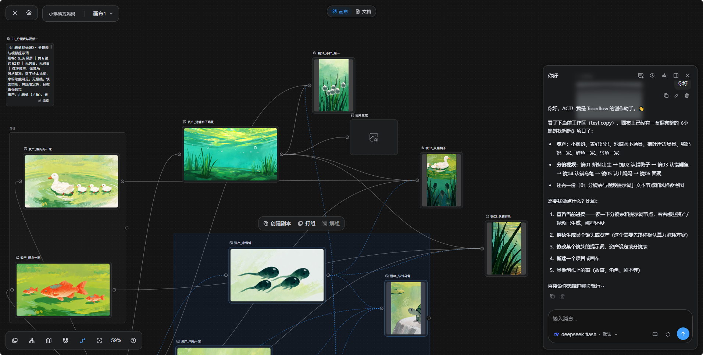</a><br /><sub>بوم خلاقیت · پوستهٔ تیره</sub>

<a href="../images/screenshots/canvasLight.png">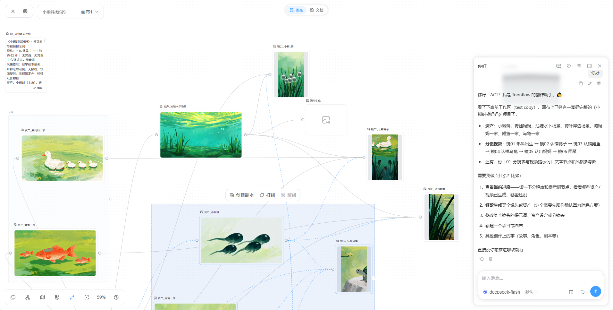</a><br /><sub>بوم خلاقیت · پوستهٔ روشن</sub>

<a href="../images/screenshots/assetCanvas.png">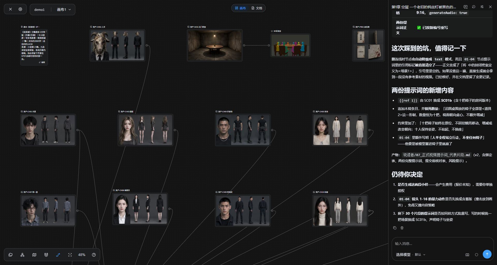</a><br /><sub>دارایی‌های شخصیت‌ها، صحنه‌ها و اشیای صحنه</sub>

<a href="../images/screenshots/directorStudio.png">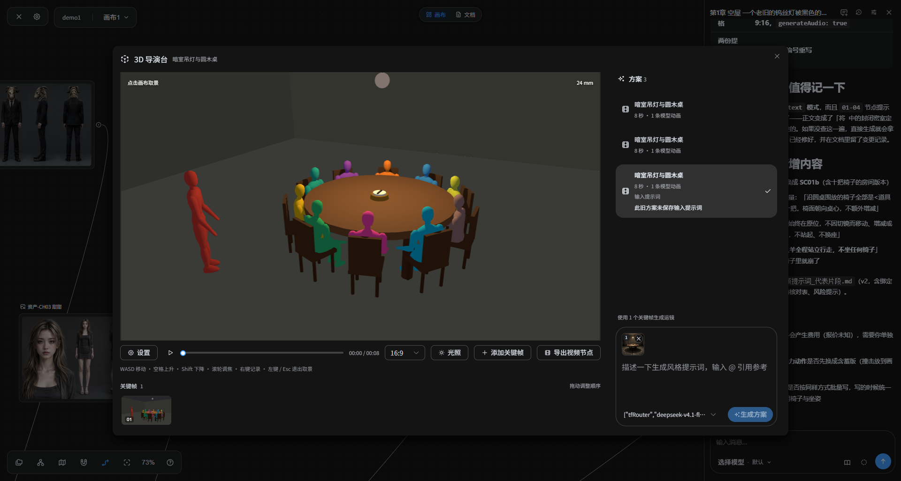</a><br /><sub>استودیوی سه‌بعدی کارگردانی و پیش‌نمایش نماها</sub>

<a href="../images/screenshots/characterImageGeneration.png">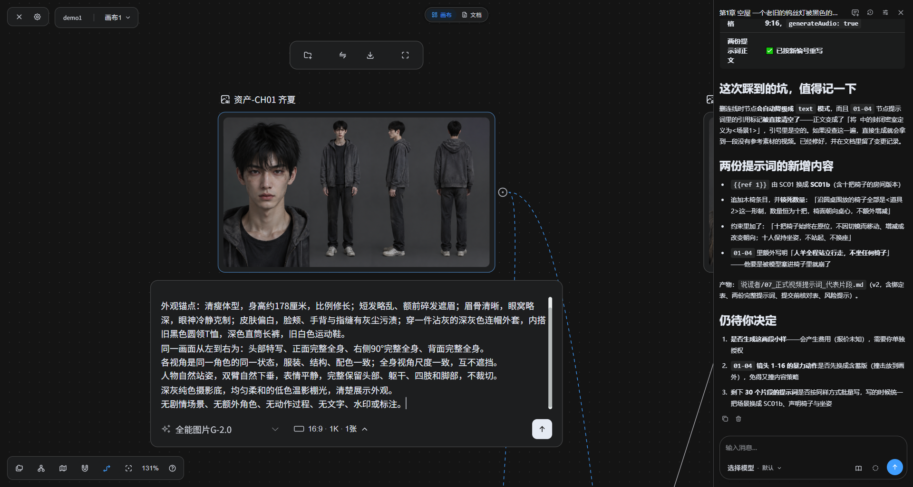</a><br /><sub>برگه‌های سه‌نمای شخصیت و تولید تصویر</sub>

<a href="../images/screenshots/videoGeneration.png">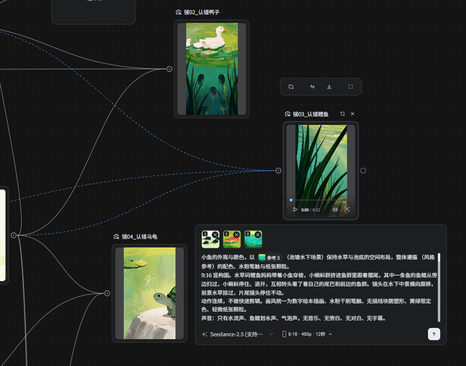</a><br /><sub>تولید ویدیو با چند دارایی مرجع</sub>

<a href="../images/screenshots/nodeMenu.png">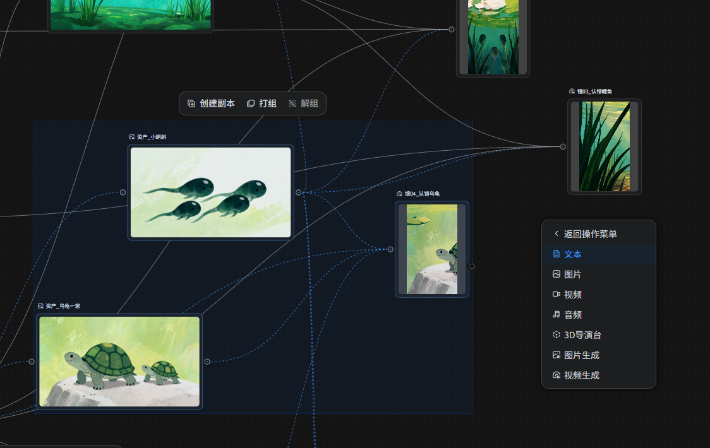</a><br /><sub>منوی گره‌ها و عملیات گروه‌بندی</sub>

<a href="../images/screenshots/pluginMarket.png">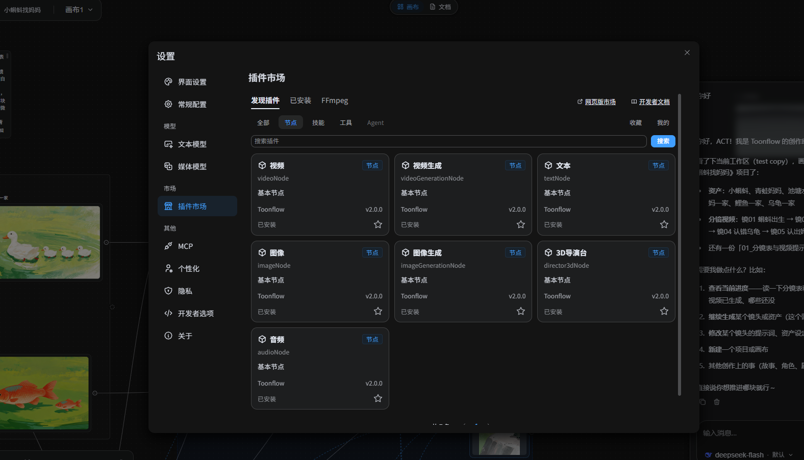</a><br /><sub>بازار افزونه‌ها</sub>

</div>

---

## 4. 🚀 دانلود و نصب

### 4.1 نصب برنامه

| سیستم‌عامل | GitHub |
| --- | --- |
| Windows | [نسخه‌های انتشار](https://github.com/ZxzZhao6668/Lum-OpenSource/releases) |
| macOS | [نسخه‌های انتشار](https://github.com/ZxzZhao6668/Lum-OpenSource/releases) |
| Android ARM64 | [دانلود APK](https://github.com/ZxzZhao6668/Lum-OpenSource/releases) |

برنامهٔ Android فقط از دستگاه‌های ARM64 پشتیبانی می‌کند. فایل `lum-VERSION-android-arm64.apk` را از صفحهٔ انتشار دانلود و نصب کنید. برنامه یک بک‌اند محلی Bun دارد و می‌تواند مستقل اجرا شود؛ همچنین از طریق «اتصال دستگاه‌ها» در صفحهٔ اصلی، با اسکن کد QR یا ورود دستی اطلاعات، به رایانه یا بک‌اندی با اشتراک‌گذاری فعال در شبکهٔ محلی یا اینترنت متصل می‌شود.

نصب‌کنندهٔ Windows به‌طور خودکار WebView2 را شناسایی و نصب می‌کند. اگر برنامه پس از نصب بلافاصله بسته شد، محیط اجرا را از [صفحهٔ دانلود WebView2](https://developer.microsoft.com/microsoft-edge/webview2/) دریافت و دستی نصب کنید.

در macOS ‏(Apple Silicon)، ‏Lum را به پوشهٔ Applications بکشید و مستقیماً باز کنید. نیازی به اجرای دستور در ترمینال از قبل نیست. اگر macOS هشدار امنیتی نشان داد، مراحل زیر را به‌ترتیب دنبال کنید.

<details>
<summary><strong>اگر نصب یا باز کردن Lum در macOS ممکن نیست</strong></summary>

**1. در بخش حریم خصوصی و امنیت، اجازهٔ اجرای Lum را بدهید**

اگر هشداری دربارهٔ تأیید نشدن توسعه‌دهنده یا ناتوانی Apple در بررسی بدافزار نشان داده شد، ابتدا برای باز کردن Lum تلاش کنید. سپس به تنظیمات سیستم ← حریم خصوصی و امنیت بروید، پیام مسدود شدن Lum را پیدا کنید، «باز کردن در هر صورت» را بزنید و تأیید کنید. [راهنمای رسمی Apple](https://support.apple.com/zh-cn/102445) را ببینید.

**2. اگر محدودیت قرنطینه همچنان مانع اجراست، ویژگی قرنطینه را حذف کنید**

پس از اطمینان از اینکه برنامه را از صفحهٔ رسمی انتشار دریافت کرده‌اید و در Applications قرار دارد، دستور زیر را در ترمینال اجرا کنید و دوباره برنامه را باز کنید. اگر نام برنامه یا محل نصب متفاوت است، مسیر را تغییر دهید.

```bash
sudo xattr -rd com.apple.quarantine /Applications/lum.app
```

**3. آخرین راه: موقتاً به برنامه‌ها از هر منبعی اجازهٔ اجرا بدهید**

اگر دو روش نخست جواب نداد و به منبع برنامه اعتماد دارید، این دستور را امتحان کنید:

```bash
sudo spctl --master-disable
```

سپس تنظیمات سیستم ← حریم خصوصی و امنیت را باز کنید. در بخش امنیت، اگر سیستم این گزینه را دارد، «اجازهٔ اجرای برنامه‌های دریافت‌شده از» را روی «هرجا» قرار دهید و تأیید کنید. گزینه‌های موجود و پشتیبانی از دستورها ممکن است در نسخه‌های مختلف macOS متفاوت باشد.

این کار محدودیت‌های امنیتی را برای همهٔ برنامه‌ها کاهش می‌دهد. پیشنهاد می‌کنیم پس از آن، تنظیم را به «App Store و توسعه‌دهندگان تأییدشده» برگردانید.

</details>

برای توضیحات بیشتر، [راهنمای کاربر](../../../../docs/user-guide.md) را ببینید.

---

<a id="docker"></a>

### 4.2 نصب با Docker

ابتدا Git، ‏[Docker Engine](https://docs.docker.com/engine/install/) و Docker Compose را نصب کنید. در Windows و macOS می‌توانید Docker Desktop را در حالت کانتینرهای Linux به کار ببرید. مخزن شامل [Dockerfile](../../Dockerfile)، ‏[پیکربندی Compose](../../compose.yaml) و [موارد مستثنا از ساخت](../../.dockerignore) است. ایمیج با Bun 1.4.3 ساخته می‌شود و FFmpeg را در خود دارد.

<details>
<summary><strong>نمایش مراحل نصب با Docker</strong></summary>

کد منبع را کلون کنید و دستورهای زیر را در ریشهٔ مخزن اجرا کنید:

```sh
git clone https://github.com/ZxzZhao6668/Lum-OpenSource.git
cd Lum-OpenSource/vendor/lum
docker compose up -d --build
```

در نخستین ساخت، وابستگی‌ها نصب و گره‌ها، ابزارها، Web و Server همراه پروژه ساخته می‌شوند. پس از راه‌اندازی، `http://127.0.0.1:3000` را باز کنید. برای میزبان راه دور، مطابق بخش «دسترسی و داده‌ها» در ادامه از تونل SSH استفاده کنید. نخستین اجرا افزونه‌های همراه را آماده می‌کند و پوشهٔ کاری `myProject` را در اختیارتان می‌گذارد.

تنظیمات، افزونه‌ها و فایل‌های پروژه در والیوم نام‌دار Docker با نام `lumData` نگهداری می‌شوند که درون کانتینر به `/app/data/` متصل است. نام واقعی والیوم پیشوند پروژهٔ Compose را نیز دارد. توقف یا ساخت دوبارهٔ کانتینر داده‌ها را حفظ می‌کند. **از `docker compose down -v` استفاده نکنید؛ این دستور والیوم داده‌ها را حذف می‌کند.**

```sh
docker compose logs -f lum  # View logs
docker compose stop             # Stop the service
docker compose start            # Start it again
docker compose down             # Remove containers, retaining the data volume
```

برای افزودن پوشهٔ پروژه، در پنجرهٔ «انتخاب پوشهٔ کاری سرور» روی «پوشهٔ جدید» کلیک کنید. این پنجره تغییر نام و حذف فایل‌ها و پوشه‌ها را هم پشتیبانی می‌کند. همچنین می‌توانید هنگام اجرای سرویس، از خط فرمان پوشه بسازید:

```sh
docker compose exec lum mkdir -p /app/data/workspaces/newProject
```

برای پشتیبان‌گیری، ابتدا سرویس را متوقف کنید، داده‌ها را کپی کنید و سپس سرویس را دوباره راه بیندازید:

```sh
docker compose stop
docker compose cp lum:/app/data ./lumBackup
docker compose start
```

</details>

---

<a id="server"></a>

### 4.3 نصب روی سرور

برای اجرای مستقیم Web و Server روی سرور Linux از این روش استفاده کنید. مثال زیر بر پایهٔ Ubuntu / Debian و نسخهٔ تعیین‌شدهٔ پروژه، یعنی [Bun 1.4.3](https://bun.sh/docs/installation)، است.

<details>
<summary><strong>نمایش مراحل نصب روی سرور</strong></summary>

محیط اجرا را نصب کنید:

```sh
sudo apt-get update
sudo apt-get install -y git curl unzip ffmpeg
curl -fsSL https://bun.com/install | bash -s "bun-v1.4.3"
export PATH="$HOME/.bun/bin:$PATH"
bun --version
```

کد منبع را کلون و سرویس را راه‌اندازی کنید:

```sh
git clone https://github.com/ZxzZhao6668/Lum-OpenSource.git
cd Lum-OpenSource/vendor/lum
bun install --frozen-lockfile

# Build bundled nodes, tools, Web, and Server
bun run build:server
mkdir -p data/workspaces/myProject
bun run start:server
```

وقتی پیام «服务启动成功» (سرویس با موفقیت راه‌اندازی شد) را دیدید، `http://127.0.0.1:3000` را روی خود سرور باز کنید. دستور بالا در پیش‌زمینه اجرا می‌شود؛ برای توقف آن `Ctrl+C` را بزنید. برای اجرای خودکار هنگام بوت و مدیریت فرایند، [راهنمای استقرار Bun با systemd](https://bun.sh/guides/ecosystem/systemd) را ببینید. پوشهٔ مخزن را به‌عنوان پوشهٔ کاری و مسیر مطلق Bun به‌همراه `run start:server` را به‌عنوان دستور شروع تعیین کنید. آن را با کاربری اجرا کنید که مجوز خواندن و نوشتن در آن پوشه را دارد.

</details>

---

### 4.4 دسترسی و داده‌ها

- سرویس در حال حاضر از پورت ثابت `3000` استفاده می‌کند. رابط وب و API احراز هویت ورود جداگانه ندارند. در نصب روی سرور، دسترسی به پورت `3000` را با دیوار آتش یا گروه امنیتی محدود کنید. دسترسی عمومی به پراکسی معکوس مجهز به احراز هویت نیاز دارد.
- برای دسترسی شخصی از راه دور، روی رایانهٔ خود `ssh -N -L 3000:127.0.0.1:3000 username@server-address` را اجرا کنید. اتصال را باز نگه دارید و سپس به `http://127.0.0.1:3000` بروید. نیازی نیست پورت `3000` سرور را در اینترنت عمومی باز کنید.
- در نصب مستقیم، تنظیمات، افزونه‌ها و فضاهای کاری به‌طور پیش‌فرض در پوشهٔ `data/` مخزن ذخیره می‌شوند. در Docker، محل آن‌ها `/app/data/` درون والیوم داده است. هنگام جابه‌جایی یا پشتیبان‌گیری، کل پوشه را نگه دارید. پس از باز کردن صفحه، `myProject` را در فضای کاری سرور انتخاب کنید. برای پروژه‌های بیشتر، در پوشهٔ `workspaces/` مربوطه زیرپوشه بسازید.
- هر دو روش نصب، FFmpeg سیستمی را شامل می‌شوند. کلیدهای API سرویس‌های مدل را همچنان باید در رابط کاربری تنظیم کنید.

---

### 4.5 استقرار ابری

[نصب با Docker](#docker) · [نصب روی سرور](#server)

---

## 5. 🎬 نمونهٔ اثر

Toonflow (HBAI-Ltd)

### جزئیات تولید

| مورد | اطلاعات ثبت‌شده در مخزن اصلی |
| --- | --- |
| زمان تولید و مدت ویدیوی نهایی | حدود 2 ساعت کار برای ویدیویی تقریباً 2 دقیقه‌ای. |
| مدل ویدیو | Seedance 2.0 |
| مدل تصویر | GPT Image 2 |
| مدل زبانی | Claude Opus 4.6 |
| هزینهٔ API مدل‌ها | حدود ¥130 CNY (یوان چین): تقریباً ¥10 برای زبان، ¥120 برای ویدیو و کمتر از ¥1 برای تصاویر. |

این هزینه‌ها ارقام ثبت‌شده برای همین نمونه‌اند و فقط جهت اطلاع ارائه شده‌اند. هزینهٔ واقعی به سرویس مدل، تعداد دفعات تولید و پارامترها بستگی دارد.

---

## 6. 👨‍👩‍👧‍👦 جامعهٔ WeChat

[جامعهٔ WeChat](../../../../docs/contact.md#community)

---

## 7. 💌 تماس با ما

[GitHub Issues](https://github.com/ZxzZhao6668/Lum-OpenSource/issues) · [تماس با ما](../../../../docs/contact.md)

---

## 8. 📜 مجوز متن‌باز

Lum تحت [MIT License](../../LICENSE) منتشر می‌شود. وابستگی‌ها و دارایی‌های شخص ثالث همچنان تابع مجوزها و اعلامیه‌های حق نشر خود هستند.

[](https://github.com/ZxzZhao6668/Lum-OpenSource/stargazers)

> **بند عدم عطف به ماسبق**: کاربرانی که نسخه‌های پیش از v1.0.8 را تحت AGPL-3.0 استفاده کرده‌اند، همچنان تابع AGPL-3.0 هستند. نسخه‌های v1.0.8 تا v1.1.8 همچنان تابع Apache-2.0 و توافق‌نامهٔ تکمیلی آن هستند. این تغییر مجوز شامل آن کاربران نمی‌شود.

---

## 9. 🙏 سپاسگزاری

- **شرکا**: 算能云، ‏Tencent Hunyuan 3D و AI Galaxy (智星云).
- **مشارکت‌کنندگان پروژه**: از همهٔ کسانی که کد نوشته‌اند، مستندات را بهبود داده‌اند، افزونه‌ها را به اشتراک گذاشته‌اند و در عیب‌یابی کمک کرده‌اند سپاسگزاریم.
- **کاربران جامعه**: از همهٔ کسانی که پیوسته بازخورد می‌دهند، آثارشان را به اشتراک می‌گذارند و از پروژه حمایت می‌کنند سپاسگزاریم.

仰起脸笑的像满月: منابع پردازشی توسعه با Codex 20x را فراهم کرد.
Xi'an Zhongxing Digital Intelligence Technology Co., Ltd. (西安中星数字智能科技有限公司): امضای برنامه با گواهی Apple را فراهم کرد.

<div align="center">

حق نشر © 2026 北京爱阿科技有限公司

</div>


