<p>
  <a href="https://github.com/ZxzZhao6668/Lum-OpenSource">
    
  </a>
</p>

<p align="center">
  <a href="../../README.md">简体中文</a> |
  <a href="./readmeZhTw.md">繁體中文</a> |
  <a href="./readmeEn.md">English</a> |
  <a href="./readmeJa.md">日本語</a> |
  <strong>Русский</strong> |
  <a href="./readmeVi.md">Tiếng Việt</a> |
  <a href="./readmeTh.md">ไทย</a>
  <br />
  <a href="./readmeKo.md">한국어</a> |
  <a href="./readmeHi.md">हिन्दी</a> |
  <a href="./readmeId.md">Bahasa Indonesia</a> |
  <a href="./readmeMs.md">Bahasa Melayu</a> |
  <a href="./readmeFil.md">Filipino</a> |
  <a href="./readmeBn.md">বাংলা</a> |
  <a href="./readmeUr.md">اردو</a>
  <br />
  <a href="./readmeTa.md">தமிழ்</a> |
  <a href="./readmeTe.md">తెలుగు</a> |
  <a href="./readmeMr.md">मराठी</a> |
  <a href="./readmePa.md">ਪੰਜਾਬੀ</a> |
  <a href="./readmeAr.md">العربية</a> |
  <a href="./readmeFa.md">فارسی</a> |
  <a href="./readmeTr.md">Türkçe</a>
</p>

> 🌐 **Поддержка 21 языка интерфейса** · [Поддерживаемые языки](#languages)

<div align="center">

<p align="center">
  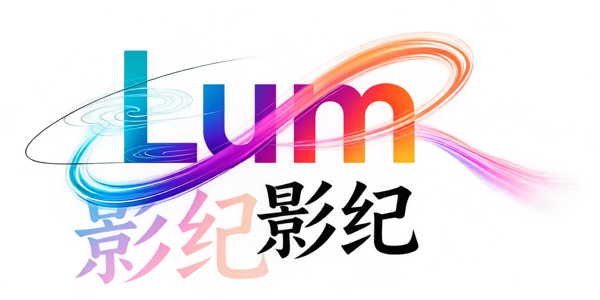
</p>

<a href="https://github.com/ZxzZhao6668/Lum-OpenSource">
  <picture>
    <source media="(prefers-color-scheme: dark)" srcset="https://readme-typing-svg.demolab.com?font=Fira+Code&size=40&duration=3000&pause=1000&color=FFFFFF&center=true&vCenter=true&width=600&lines=Lum;%D0%98%D0%98-%D1%81%D1%82%D1%83%D0%B4%D0%B8%D1%8F%20%D0%BA%D0%BE%D1%80%D0%BE%D1%82%D0%BA%D0%B8%D1%85%20%D0%B4%D1%80%D0%B0%D0%BC;%D0%9E%D0%B6%D0%B8%D0%B2%D0%BB%D1%8F%D0%B9%D1%82%D0%B5%20%D1%81%D0%B2%D0%BE%D0%B8%20%D0%B8%D1%81%D1%82%D0%BE%D1%80%D0%B8%D0%B8" />
    
  </picture>
</a>

<p align="center">
  <a href="https://github.com/ZxzZhao6668/Lum-OpenSource/stargazers">
    
  </a>
  <a href="../../LICENSE">
    
  </a>
  <a href="https://github.com/ZxzZhao6668/Lum-OpenSource/releases">
    
  </a>
</p>
<p align="center">
  <a href="https://github.com/ZxzZhao6668/Lum-OpenSource/forks">
    
  </a>
</p>
<p align="center">
  <a href="https://github.com/ZxzZhao6668/Lum-OpenSource/issues">
    
  </a>
  <a href="https://github.com/ZxzZhao6668/Lum-OpenSource/graphs/contributors">
    
  </a>
  <a href="https://github.com/ZxzZhao6668/Lum-OpenSource/commits">
    
  </a>
</p>
<p align="center">
  &nbsp;
  &nbsp;
  &nbsp;
  
</p>


**Открытая ИИ-платформа для создания коротких драм, анимированных комиксов и видео**

> 🚀 **Всё для создания коротких драм**：Пишите сценарии, управляйте материалами, создавайте изображения и видео, организуя весь творческий процесс на бесконечном холсте.

</div>

<p align="center">
  <a href="https://github.com/ZxzZhao6668/Lum-OpenSource/releases">Скачать приложение</a> ·
  <a href="../../../../docs/user-guide.md">Руководство пользователя</a> ·
  <a href="../../../../marketplace/README.md">Каталог плагинов</a> ·
  <a href="../development.md">Документация для разработчиков</a> ·
  <a href="../../../../docs/user-guide.md#配置-ai">Настройка моделей</a>
</p>

---

## 1. 💛 Спонсоры и поддержка

Благодарим следующих партнёров за поддержку открытого проекта Toonflow (HBAI-Ltd).

Metaso · APIMart · CompShare

[Lum · Стать спонсором](../../../../docs/contact.md#business)

---

## 2. 🌟 Возможности

Lum — открытая ИИ-платформа для создания коротких драм, анимированных комиксов и коротких видео. Она объединяет сценарии, материалы и видеоклипы на одном бесконечном холсте.

| Возможность | Описание |
| --- | --- |
| 🏠 **Локальное развёртывание** | Храните проекты и материалы на своём устройстве или сервере. Доступны настольное приложение, Android, Docker и установка на сервер. |
| 🖼️ **Бесконечный холст** | Размещайте сценарии, персонажей, сцены и видеоклипы на одном холсте. |
| 🔌 **MCP** | Подключайте внешние инструменты и сервисы через MCP. |
| 🧩 **Каталог плагинов** | Добавляйте узлы, инструменты и творческие возможности через [каталог плагинов](../../../../marketplace/README.md). |
| 🤖 **Открытая система агентов** | Открытый доступ к промптам, инструментам и A2A для настройки поведения агентов и взаимодействия с внешними агентами. |
| 🔧 **Свободное подключение моделей** | Настраивайте сторонние API или подключайте локальные ComfyUI и LLM. |
| 🌐 **Поддержка языков** | Интерфейс доступен на 21 языке. |

<a id="languages"></a>

### Поддержка языков

Поддерживаемые языки: 简体中文, 繁體中文, English, 日本語, Русский, Tiếng Việt, ไทย, 한국어, हिन्दी, Bahasa Indonesia, Bahasa Melayu, Filipino, বাংলা, اردو, தமிழ், తెలుగు, मराठी, ਪੰਜਾਬੀ, العربية, فارسی, Türkçe.

---

## 3. 📸 Скриншоты

<div align="center">

<a href="../images/screenshots/projectHome.png">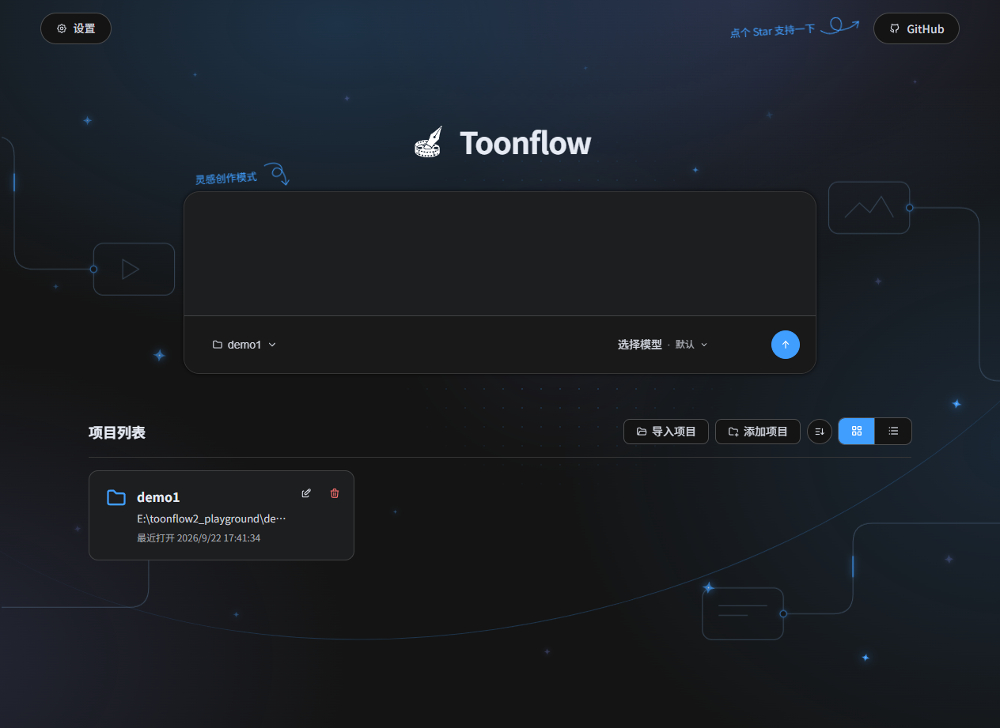</a><br /><sub>Главная страница проектов и работа с идеями</sub>

<a href="../images/screenshots/quickStart.png">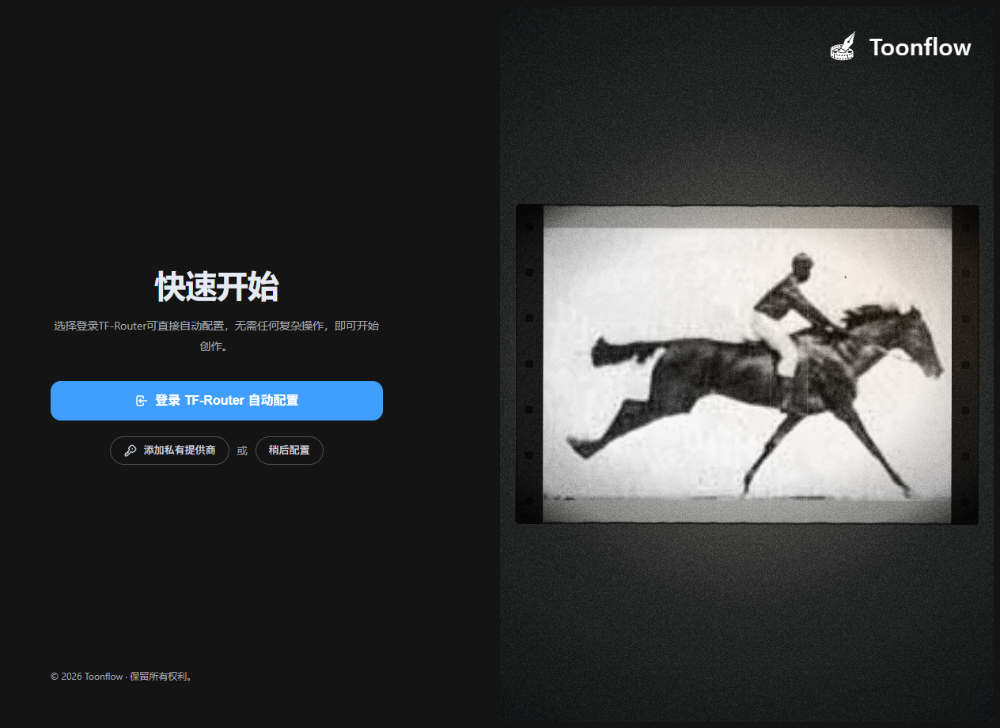</a><br /><sub>Первый запуск и быстрая настройка</sub>

<a href="../images/screenshots/canvasDark.png">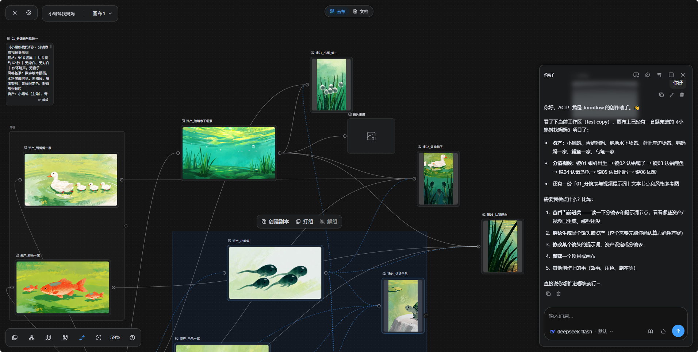</a><br /><sub>Творческий холст · Тёмная тема</sub>

<a href="../images/screenshots/canvasLight.png">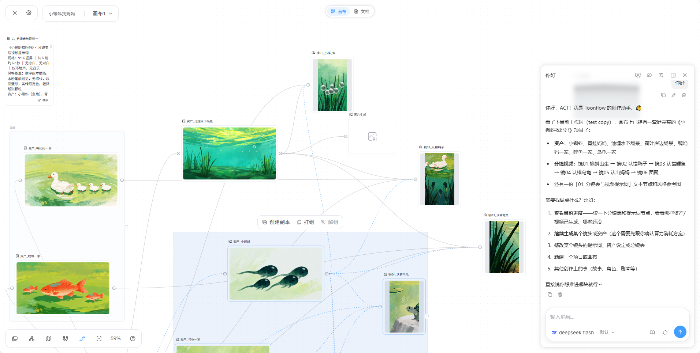</a><br /><sub>Творческий холст · Светлая тема</sub>

<a href="../images/screenshots/assetCanvas.png">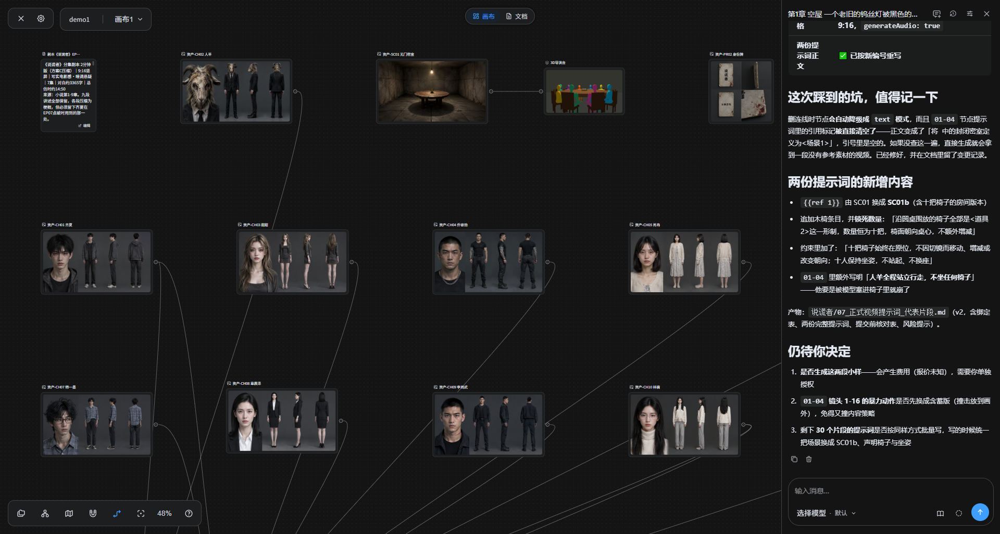</a><br /><sub>Материалы персонажей, сцен и реквизита</sub>

<a href="../images/screenshots/directorStudio.png">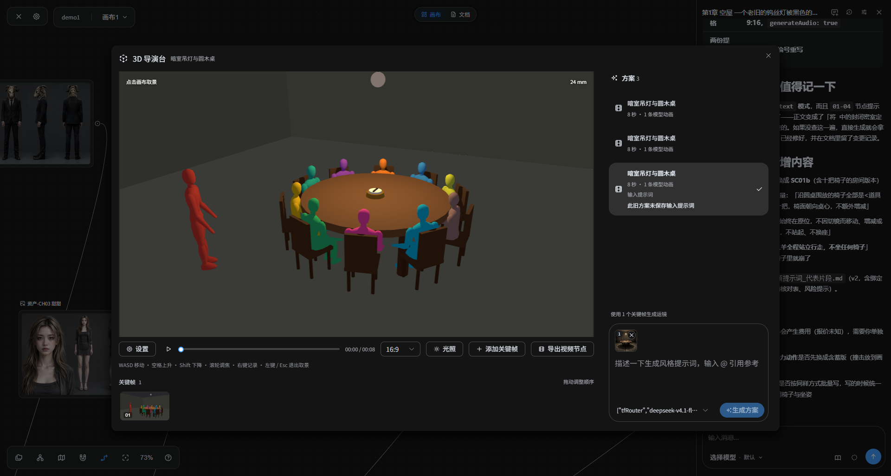</a><br /><sub>3D-студия режиссёра и предварительная визуализация кадров</sub>

<a href="../images/screenshots/characterImageGeneration.png">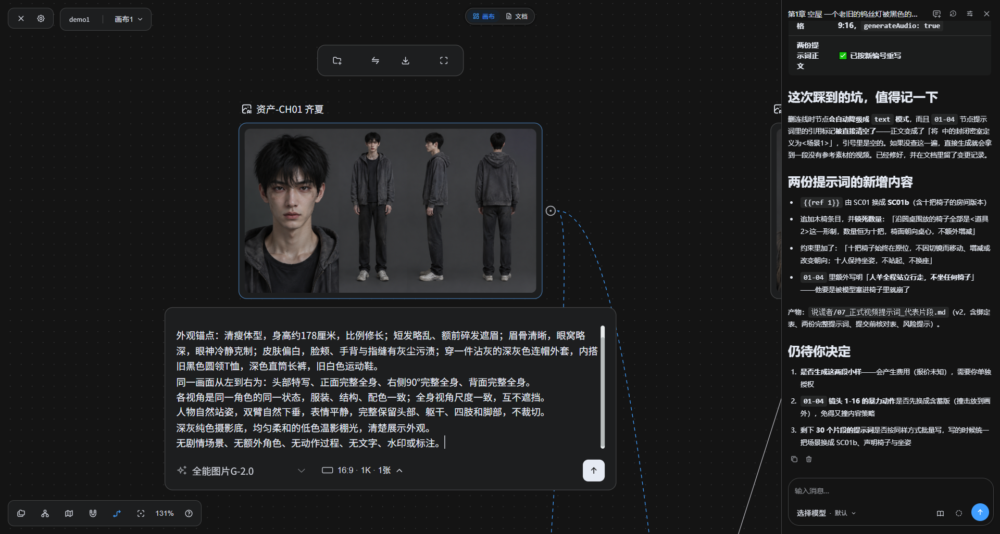</a><br /><sub>Персонажи в трёх проекциях и генерация изображений</sub>

<a href="../images/screenshots/videoGeneration.png">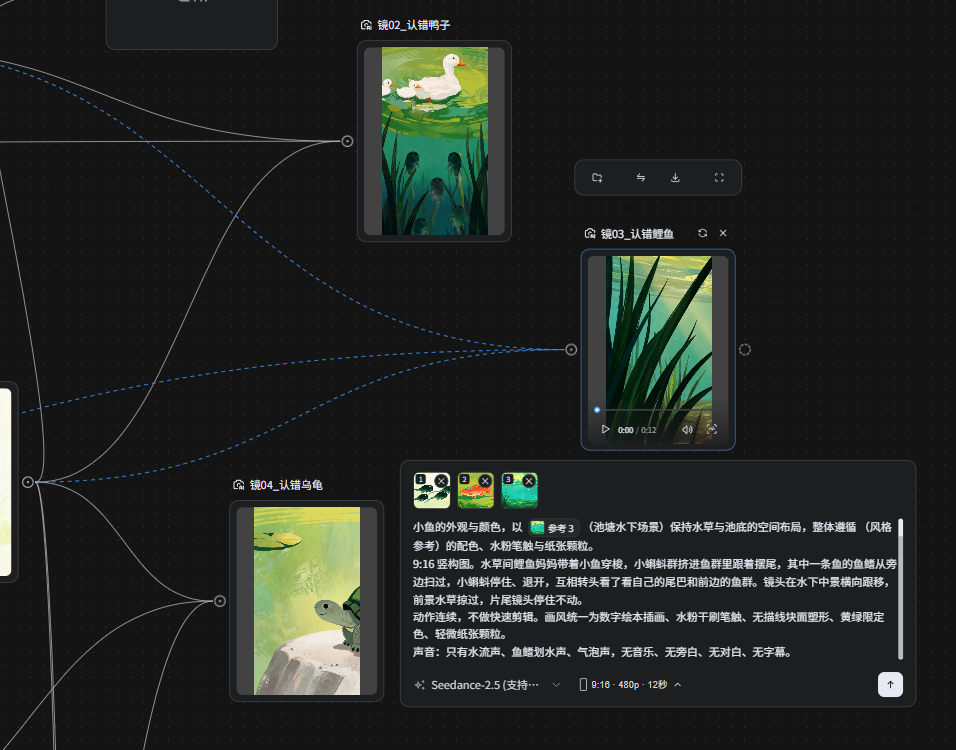</a><br /><sub>Генерация видео по нескольким референсам</sub>

<a href="../images/screenshots/nodeMenu.png">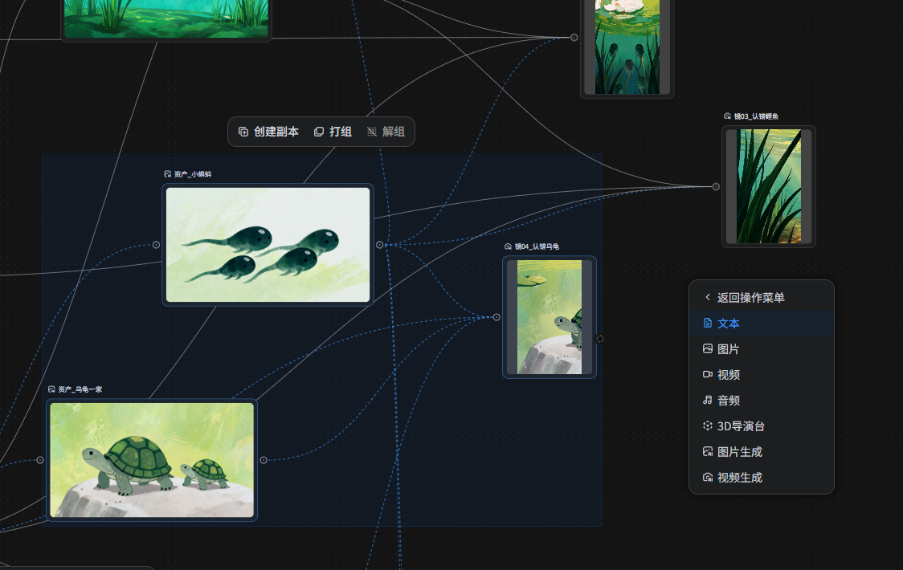</a><br /><sub>Меню узлов и операции с группами</sub>

<a href="../images/screenshots/pluginMarket.png">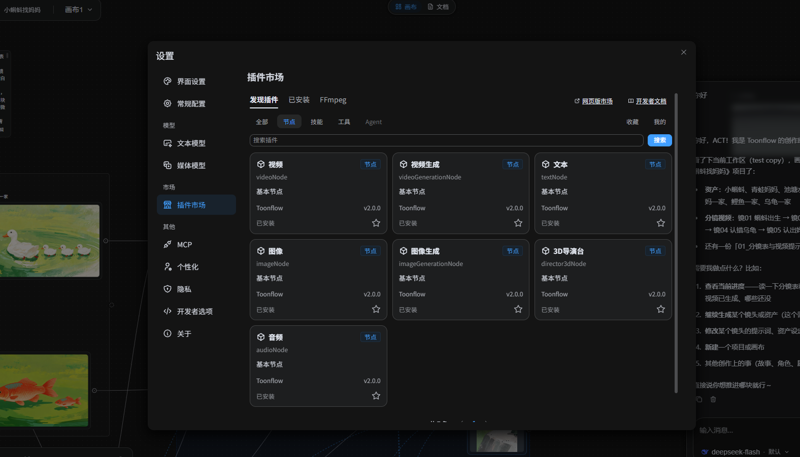</a><br /><sub>Каталог плагинов</sub>

</div>

---

## 4. 🚀 Скачивание и установка

### 4.1 Установка приложения

| Операционная система | GitHub |
| --- | --- |
| Windows | [Релиз](https://github.com/ZxzZhao6668/Lum-OpenSource/releases) |
| macOS | [Релиз](https://github.com/ZxzZhao6668/Lum-OpenSource/releases) |
| Android ARM64 | [Скачать APK](https://github.com/ZxzZhao6668/Lum-OpenSource/releases) |

Приложение для Android поддерживает только устройства ARM64. Скачайте и установите `lum-VERSION-android-arm64.apk` со страницы релиза. В приложение встроен локальный бэкенд Bun, поэтому оно может работать самостоятельно. Через «Связь устройств» на главной странице можно отсканировать QR-код или вручную подключиться к компьютеру либо удалённому бэкенду с включённым общим доступом через локальную сеть или интернет.

Установщик Windows автоматически проверяет наличие WebView2 и устанавливает его при необходимости. Если после установки приложение сразу закрывается, установите среду выполнения вручную со [страницы загрузки WebView2](https://developer.microsoft.com/microsoft-edge/webview2/).

В macOS (Apple Silicon) перетащите Lum в папку «Программы» и откройте приложение. Заранее выполнять команды в терминале не требуется. Если появится предупреждение системы безопасности, последовательно выполните следующие действия.

<details>
<summary><strong>Что делать, если Lum не устанавливается или не открывается в macOS</strong></summary>

**1. Разрешите запуск Lum в разделе «Конфиденциальность и безопасность»**

Если система сообщает, что не может проверить разработчика или что Apple не может проверить приложение на наличие вредоносного ПО, сначала попробуйте открыть Lum. Затем перейдите в «Системные настройки → Конфиденциальность и безопасность», найдите сообщение о блокировке Lum, нажмите «Всё равно открыть» и подтвердите действие. Подробнее — в [официальной инструкции Apple](https://support.apple.com/zh-cn/102445).

**2. Если запуск по-прежнему блокируется карантином системы, попробуйте удалить атрибут карантина**

Убедитесь, что приложение получено с официальной страницы релизов и помещено в папку «Программы». Выполните следующую команду в терминале и попробуйте открыть приложение снова. Если имя приложения или место установки отличаются, измените путь.

```bash
sudo xattr -rd com.apple.quarantine /Applications/lum.app
```

**3. Крайняя мера: временно разрешить приложения из любых источников**

Если первые два способа не помогли и вы доверяете источнику приложения, попробуйте выполнить:

```bash
sudo spctl --master-disable
```

Затем откройте «Системные настройки → Конфиденциальность и безопасность». В разделе безопасности выберите «Любой источник» для разрешённых источников загрузки приложений, если система предлагает такой вариант, и подтвердите действие. Доступные настройки и поддержка команды зависят от версии macOS.

Это ослабляет ограничения безопасности для всех приложений. После завершения рекомендуется снова разрешить приложения только из App Store и от проверенных разработчиков.

</details>

Дополнительные инструкции приведены в [руководстве пользователя](../../../../docs/user-guide.md).

---

<a id="docker"></a>

### 4.2 Установка через Docker

Сначала установите Git, [Docker Engine](https://docs.docker.com/engine/install/) и Docker Compose. В Windows и macOS можно использовать Docker Desktop в режиме контейнеров Linux. В репозитории есть [Dockerfile](../../Dockerfile), [конфигурация Compose](../../compose.yaml) и [правила исключения файлов из сборки](../../.dockerignore). Образ собирается на Bun 1.4.3 и содержит FFmpeg.

<details>
<summary><strong>Показать шаги установки через Docker</strong></summary>

Клонируйте исходный код и выполните команды в корневой папке репозитория:

```sh
git clone https://github.com/ZxzZhao6668/Lum-OpenSource.git
cd Lum-OpenSource/vendor/lum
docker compose up -d --build
```

При первой сборке устанавливаются зависимости и собираются встроенные узлы, инструменты, Web и Server. После запуска откройте `http://127.0.0.1:3000`. Для удалённого сервера используйте SSH-туннель, описанный ниже в разделе «Доступ и данные». При первом запуске инициализируются встроенные плагины и создаётся рабочая папка `myProject`.

Настройки, плагины и файлы проектов хранятся в именованном томе Docker `lumData`, подключённом к `/app/data/` внутри контейнера. Фактическое имя тома содержит префикс проекта Compose. Данные сохраняются при остановке или пересборке контейнера. **Не используйте `docker compose down -v`: эта команда удаляет том с данными.**

```sh
docker compose logs -f lum  # Просмотр журналов
docker compose stop             # Остановка сервиса
docker compose start            # Повторный запуск
docker compose down             # Удаление контейнеров с сохранением тома данных
```

Чтобы добавить папку проекта, нажмите «Новая папка» в диалоге «Выбор рабочей папки на сервере». В этом же диалоге можно переименовывать и удалять файлы и папки. Также можно создать папку из командной строки, пока сервис запущен:

```sh
docker compose exec lum mkdir -p /app/data/workspaces/newProject
```

Для резервного копирования сначала остановите сервис, скопируйте данные и запустите его снова:

```sh
docker compose stop
docker compose cp lum:/app/data ./lumBackup
docker compose start
```

</details>

---

<a id="server"></a>

### 4.3 Установка на сервер

Этот вариант позволяет запускать Web и Server непосредственно на сервере Linux. Ниже приведён пример для Ubuntu / Debian с указанной в проекте версией [Bun 1.4.3](https://bun.sh/docs/installation).

<details>
<summary><strong>Показать шаги установки на сервер</strong></summary>

Установите среду выполнения:

```sh
sudo apt-get update
sudo apt-get install -y git curl unzip ffmpeg
curl -fsSL https://bun.com/install | bash -s "bun-v1.4.3"
export PATH="$HOME/.bun/bin:$PATH"
bun --version
```

Клонируйте исходный код и запустите сервис:

```sh
git clone https://github.com/ZxzZhao6668/Lum-OpenSource.git
cd Lum-OpenSource/vendor/lum
bun install --frozen-lockfile

# Сборка встроенных узлов, инструментов, Web и Server
bun run build:server
mkdir -p data/workspaces/myProject
bun run start:server
```

Когда появится сообщение «服务启动成功» («Сервис успешно запущен»), откройте `http://127.0.0.1:3000` на самом сервере. Приведённая команда запускает сервис на переднем плане; для остановки нажмите `Ctrl+C`. Для автозапуска и управления процессом воспользуйтесь [руководством Bun по развёртыванию с systemd](https://bun.sh/guides/ecosystem/systemd). Укажите папку репозитория в качестве рабочего каталога, а в команде запуска — абсолютный путь к Bun и `run start:server`. Запускайте сервис от пользователя с правами чтения и записи в эту папку.

</details>

---

### 4.4 Доступ и данные

- Сервис использует фиксированный порт `3000`. У веб-интерфейса и API нет отдельной аутентификации при входе. При установке на сервер ограничьте доступ к порту `3000` с помощью межсетевого экрана или группы безопасности. Для публичного доступа необходимо настроить обратный прокси с аутентификацией.
- Для личного удалённого доступа выполните на своём компьютере `ssh -N -L 3000:127.0.0.1:3000 username@server-address`. Не закрывая соединение, откройте `http://127.0.0.1:3000`. Открывать порт `3000` сервера для всего интернета не требуется.
- При прямой установке настройки, плагины и рабочие пространства по умолчанию хранятся в папке `data/` репозитория. При установке через Docker — в `/app/data/` внутри тома данных. При переносе или резервном копировании сохраняйте всю папку целиком. Открыв страницу, выберите `myProject` в рабочем пространстве сервера. Для дополнительных проектов создавайте подпапки в соответствующей папке `workspaces/`.
- Оба способа установки включают системный FFmpeg. Ключи API сервисов моделей нужно настроить в интерфейсе.

---

### 4.5 Развёртывание в облаке

[Установка через Docker](#docker) · [Установка на сервер](#server)

---

## 5. 🎬 Пример работы

Toonflow (HBAI-Ltd)

### Сведения о создании

| Параметр | Данные из исходного репозитория |
| --- | --- |
| Время работы и длительность видео | Около 2 часов работы, готовое видео — около 2 минут. |
| Видеомодель | Seedance 2.0 |
| Модель изображений | GPT Image 2 |
| Языковая модель | Claude Opus 4.6 |
| Стоимость вызовов моделей | Около ¥130 CNY (китайских юаней): примерно ¥10 за языковую модель, ¥120 за видео и менее ¥1 за изображения. |

Это зафиксированные расходы для данного примера, приведённые только для справки. Фактическая стоимость зависит от сервиса моделей, количества генераций и параметров.

---

## 6. 👨‍👩‍👧‍👦 Сообщество в WeChat

[Сообщество в WeChat](../../../../docs/contact.md#community)

---

## 7. 💌 Связаться с нами

[GitHub Issues](https://github.com/ZxzZhao6668/Lum-OpenSource/issues) · [Связаться с нами](../../../../docs/contact.md)

---

## 8. 📜 Лицензия открытого исходного кода

Lum распространяется по [лицензии MIT](../../LICENSE). Сторонние зависимости и материалы регулируются собственными лицензиями и уведомлениями об авторских правах.

[](https://github.com/ZxzZhao6668/Lum-OpenSource/stargazers)

> **Отсутствие обратной силы**: пользователи, использовавшие версии до v1.0.8 по AGPL-3.0, продолжают соблюдать AGPL-3.0. Для версий с v1.0.8 по v1.1.8 сохраняются Apache-2.0 и дополнительное соглашение. Изменение лицензии на них не распространяется.

---

## 9. 🙏 Благодарности

- **Партнёры**: 算能云, Tencent Hunyuan 3D и AI Galaxy (智星云).
- **Участники проекта**: спасибо всем, кто пишет код, улучшает документацию, делится плагинами и помогает устранять проблемы.
- **Пользователи сообщества**: спасибо всем, кто продолжает оставлять отзывы, делиться своими работами и поддерживать развитие проекта.

仰起脸笑的像满月: предоставлены вычислительные ресурсы Codex 20x для разработки.
西安中星数字智能科技有限公司: предоставлена подпись сертификатом Apple.

<div align="center">

Copyright © 2026 北京爱阿科技有限公司

</div>


